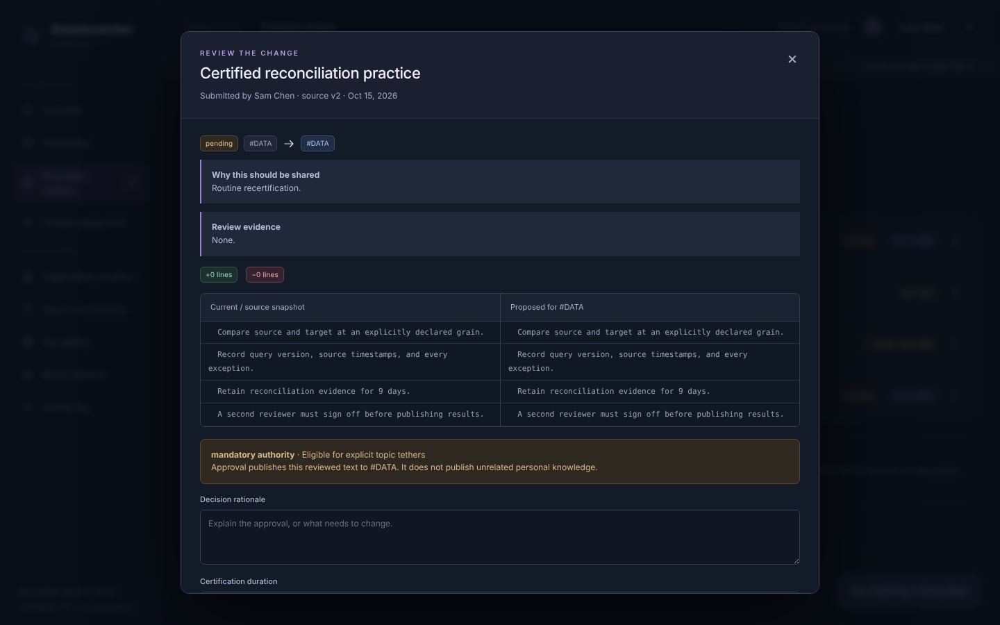
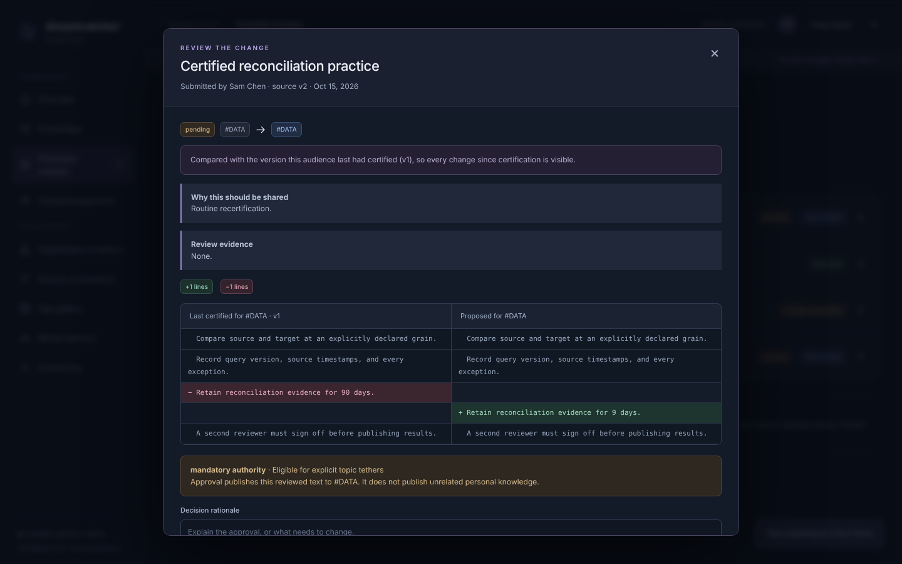

# Adversarial review: Dreamcatcher Context

Reviewed commit: `95a3c2f` (initial implementation). Fixes are on branch `claude/red-team-review`.
Date: 2026-10-15. All people, units, tokens, policies and records used here are synthetic. No company system was connected.

Runtime used: Node.js 24.22.0 (built-in SQLite 3.53.4), Chromium through Playwright 1.56.1, the official MCP Python SDK 2.2.0, and a real Bifrost gateway (transport v2.3.0, started through `@maximhq/bifrost` 1.6.3) running locally.

## The question

> Could this system confidently provide the wrong context, leak knowledge, publish an unapproved standard, or make an AI client appear governed when it is not?

**On commit `95a3c2f`, yes, all four.** Each was reproduced with synthetic data, and each passed the shipped test suite (33/33 green):

| Failure class | Demonstrated on the original | Probe / test |
|---|---|---|
| Publishes an unreviewed standard | A manager cuts a mandatory retention rule from 90 to 9 days. The recertification review shows **"+0 lines −0 lines"** and both columns read "9 days". The delegate approves it. | P1 |
| Publishes an unapproved standard | A pending revision proposal **resurrects a standard the manager had retired**. | P2 |
| Leaks knowledge | The reviewer sees private lines the submitter **deliberately deleted** before submitting. A delegate who **transferred to another team** still sees submission snapshots and can approve. | P12, P3 |
| Leaks knowledge (deployment) | Through a real Bifrost gateway, two people sharing one virtual key: the second person receives **the first person's private context**. | Bifrost run |
| Confidently wrong context | "Tickets assigned to Sam", "Tickets I created but do not own", "Jira tickets **not** assigned to me", "my org's tickets" and "my manager's tickets" all return `assignee = currentUser()` with status **ready**. | P6 |
| Confidently wrong context | "How do I reconcile the ledger?" misses the user's own mandatory team standard (word form) and returns only another department's tethered guidance, status **ready**. "Should I record a video?" injects the reconciliation standard as a **required** constraint. | P7 |
| Appears governed when it is not | MCP `get_knowledge` returns an **expired** mandatory standard as `status: certified`. `search_knowledge` returns another department's tethered mandate as `authority: mandatory`, with nothing saying it is not binding. | P4, P5 |
| Appears governed when it is not | The packet claims **~100 tokens** against a 500-token budget while delivering **~10,700**. At 10k items it delivers 358 KB while claiming 3,991 tokens. | P10 |
| Appears governed when it is not | The shipped Bifrost setup **does not work** on Bifrost v2.3.0. The documented "send your context token as `Authorization`" step is rejected by the gateway. | Bifrost run |

After the fixes, 20 of 21 probes are refuted. The remaining one, injection text inside a relevant item, is inherent to retrieval and is mitigated only by labeling (H1). Policy-dependent behaviors that were kept on purpose are marked **[POLICY]**.

### Most serious demonstrated failure: a recertification review that hides the change

`src/engine.js:97–100` (original) built the review's "before" from the item's *current* state. When a manager edits a certified standard, the item becomes `needs_review` at v2. A recertification proposal then diffs v2 against v2, so the reviewer sees no change even though the content differs from what was last certified. The approval publishes it.

| Original (reviewer sees no change) | Fixed (diffed against last certified v1) |
|---|---|
|  |  |

The fix diffs against the last *certified* revision (`Engine.lastCertified`), labels the diff base, and is covered by `recertification is reviewed against the last certified version…` in `test/redteam.test.js`.

## Mission coverage verdict

| Mission element | Verdict | Evidence and gaps |
|---|---|---|
| Identify knowledge sources and explain how to connect them | **Demonstrated** | Catalog, guidance and setup UI work in a browser. Jira/Confluence/GitLab discovery is exercised only against mocked responses; no real tenant was available. Manufacturo, NX and BigQuery are honest normalized-export imports, with no invented API. |
| Promotion and certification (individual → team → department → organization) | **Implemented and verified (after fixes)** | One level at a time, explicit consent, no self-approval, exact-scope reviewers, diff against last certified version, blockers for stale or retired sources and targets, validation inside the write transaction, preserved private original, immutable revisions. Business policy items remain open (see below). |
| Diff-like manager review screen | **Implemented and browser-verified** | Desktop and phone. Request changes, reject, approve, repeated clicks, stale blocking and provenance were all exercised in Chromium. |
| Retrieve context for a person and request | **Implemented, partially verified** | Authorization before ranking held on every surface tested. Intent is rule-based and now refuses to guess. **Missing:** team/person-to-Jira mappings (team and person ticket requests are blocked, not executed), applicability fields (site, part, work order, accounting period), and detection of contradictions in prose. Retrieval is lexical. |
| Hierarchy informs context without "org always wins" | **Implemented** | Personal focus by default; certified mandatory standards constrain only within declared topics; tethered mandates arrive as guidance. |
| One home team; tethers without second membership | **Implemented** | Directional, two-party, topic-limited, non-transitive, revocable. **Missing:** tether expiry. |
| Private, shared and team-endorsed apps | **Implemented** | Audience, endorsement and dependencies are distinct. A dependency change suspends the endorsement (verified in the browser). There is no executable-permission model; the docs say so. |
| Deliver context through Bifrost into an AI tool | **Unverified as shipped; verified locally with corrections** | The shipped config fails on a real Bifrost v2.3.0. A corrected config isolates two users end to end through the gateway. Guaranteed pre-answer context use is **missing**: it needs a trusted hook (see "Where enforcement must live"). |
| Authenticated deployment | **Implemented for a pilot** | Static per-user tokens, identity file applied on every start, demo mode cannot open an authenticated database. No SSO. |

## What the original got right

These held under attack on the original commit and were left alone:

- Authorization happens before ranking and explanation on REST, MCP, bootstrap and the exclusion trace.
- No manager or organization owner can read personal notes.
- Authenticated mode derives identity from the token only: demo headers, body `userId` and model-supplied MCP arguments are ignored or rejected (browser and MCP SDK verified).
- Self-approval is blocked and review authority is limited to the exact scope.
- Tethers are directional and non-transitive.
- App dependency audience is checked at approval.
- UI escaping and CSP hold.
- Double-click approval is safe within one process.
- Errors do not reveal whether a private item exists.

## Findings

Severity reflects demonstrated impact on the mission question. Line references point to the original commit `95a3c2f`.

| # | Sev. | Finding | Affected code (original) | Reproduction | Correction | Status |
|---|---|---|---|---|---|---|
| F1 | Critical | Recertification and revision reviews diff against the current, already-edited item, hiding changes made since certification | `engine.js:97–100` | P1; test *recertification is reviewed against the last certified version* | Diff base = last certified revision, labeled in the UI | Fixed |
| F2 | Critical (deploy) | Shipped Bifrost integration is non-functional, and the working Bifrost pattern leaks context across people who share a virtual key | `config/bifrost.example.json`, `server.js:55`, `docs/INTEGRATION.md` | Real Bifrost v2.3.0 run (below) | Lowercase per-user key; corrected guide: one Bifrost identity per person, admin verification, per-user submission; UI guidance | Config fixed; shared-key risk is a deployment control |
| F3 | High | Any `CONTEXT_MODE` value other than `authenticated` silently means demo. An authenticated database can be reopened in demo mode, giving `X-Demo-User` impersonation of real people | `server.js:85`, `server.js:16` | P11; tests *unrecognized CONTEXT_MODE…*, *authenticated database cannot be reopened in demo mode* | Strict `parseMode`; database mode pinned in a `meta` row; demo refuses databases the demo seed did not create | Fixed |
| F4 | High | A stale proposal can resurrect a retired target standard (retiring does not bump the version the gate checks) | `engine.js:112`, `engine.js:77–80` | P2; test *cannot resurrect a retired target* | `proposalBlocker` rejects retired targets and targets created after submission | Fixed |
| F5 | High | Delegations survive transfer out of the scope, deactivation, and replacement of the granting manager. The lapsed delegate keeps approval authority and sees private submission snapshots | `engine.js:21–23` | P3; test *delegation lapses on transfer…* | `activeDelegation`: grantor must still be the manager; delegate must be an active member | Fixed **[POLICY: grantor-replacement rule]** |
| F6 | High | The intent resolver answers other-person, negated, reporter, "my org" and ambiguous-unit ticket requests with the caller's own assigned tickets, marked ready. "Reconciliation issues" triggers a Jira plan | `engine.js:185–194, 229–230` | P6 (11 of 15 wrong); test *intent: ticket requests…* | Deterministic intent: reporter, open/closed, person, relation, negation, time and weak-unit detection. Anything inexpressible is **blocked with a clarification**, never substituted | Fixed |
| F7 | High | One incidental body word makes an unrelated mandatory standard "required"; a word-form miss drops the applicable mandate while status stays ready | `engine.js:13, 202–211` | P7; test *declared topics, not incidental words…* | Function-word stoplist; deterministic word-form match; mandatory applicability requires a declared topic (tag) or an app requirement; title and body mentions need two distinct terms and never bind | Fixed (lexical limits remain) |
| F8 | High | The reviewer receives the submitter's full private original, including lines removed from the submitted text | `engine.js:100` | P12; test *reviewers receive only the submitted text…* | For private sources, the diff base is an empty baseline ("nothing published at this scope") | Fixed **[POLICY]** |
| F9 | High | MCP `get_knowledge` / `search_knowledge` present expired standards as certified and tethered mandates as mandatory | `mcp.js:27–29` | P4, P5; test *MCP retrieval labels…* | Per-caller `governance {usable, binding, audience, note}` and `effectiveStatus` on MCP and REST reads | Fixed |
| F10 | High | The budget counts only item bodies. The exclusion trace lists every visible item, so unrelated titles (including injected text) reach the model on every request | `engine.js:210, 225–228` | P10, P18; test *budget covers the complete delivered packet…* | Budget measured on the serialized packet; no-match items counted, not listed; trace capped | Fixed |
| F11 | Medium | Validation runs outside `BEGIN IMMEDIATE`. Two processes can double-approve, publishing two certified copies and overwriting decision history | `engine.js:103–128` (and other mutators) | P16; test *second database handle cannot approve…* | Every mutator validates inside its write transaction | Fixed (single instance remains the supported topology) |
| F12 | Medium | Re-importing a reused source revision with changed content reports `unchanged` and keeps stale text, such as an old torque value | `engine.js:174` | P8; test *reused source revision…* | Content compared; changed content is imported as a new version, flagged `revisionReused`, and invalidates derivatives | Fixed |
| F13 | Medium | Identity changes are ignored after first start: transfers keep old access, and removed people keep authority until their token is removed | `server.js:17–25` | test *identity file is applied on every start…* | Identity file applied on each start; absent people deactivated (401); audited | Fixed (SSO still required) |
| F14 | Medium | Imported (possibly restricted) source content can be promoted with no provenance shown to the reviewer | `app.js` `review()` | P13; test *review shows provenance…* | Provenance block and an explicit audience warning in the review | Fixed **[POLICY: may restricted sources be promoted at all?]** |
| F15 | Medium | People with IDs like `pat-lee` and `pat_lee` share one connector credential slot; one discovers with the other's credential | `connectors.js:16` | P9; test *same connector credential name…* | Fail closed on ambiguous credential names | Fixed |
| F16 | Medium | Cascaded decertification writes no audit record. An individual's private edit or retirement suspends an org-wide standard (authority inversion) | `engine.js:65–69` | P14, P20; test *suspending derived certifications is audited…* | Audited for the affected audience without naming the private source | Audit fixed; **[POLICY]** behavior kept |
| F17 | Medium | Bootstrap scans and authorizes every audit event, and every AI request adds one: 2.9 s at 20k events, 9.8 s at 100k | `engine.js:45–48` | `scale.mjs` | Newest-first, SQL-prefiltered paging | Fixed: 60–93 ms / 349–607 ms |
| F18 | Medium | Reviewers are not told a proposal went stale when they cannot read the private source; stale proposals cannot be closed | `app.js` `review()`, `engine.js:111` | P15; test *reviewers see why a proposal is stale…* | Server-computed `blockedReason`; approve disabled; reject and request-changes still allowed | Fixed |
| F19 | Low | A user ID equal to a unit ID turns that unit's approved standards into "personal" items nobody else can read | `server.js:22` | P17; identity test | Identity loader requires distinct IDs | Fixed |
| F20 | Low | A malformed source payload crashes discovery with HTTP 500 | `connectors.js:30–32` | P19; test *malformed source payloads…* | Shape validation → 502 "nothing was recorded"; Confluence status labeled as publication, not QMS approval | Fixed |
| H1 | Inherent | Injection text inside a *relevant* item (for example, an imported page) is delivered as evidence | — | P18b | Evidence and instructions are separated and labeled; tool execution must be authorized outside the model | Open by nature |
| H2 | Hypothesis | A gateway-level semantic or response cache keyed without the user could serve one person's context-informed answer to another | — | Not tested | Keep caches per identity or disabled for this client | Unverified |
| H3 | Observed | A 401 carries no `WWW-Authenticate` or OAuth protected-resource metadata, so MCP clients that rely on OAuth discovery cannot connect directly | `server.js:29` | MCP SDK run | Use through a gateway with per-user credentials, or add OAuth 2.1 when SSO is chosen | Open (deployment choice) |

### Real Bifrost results (F2)

Run locally against Bifrost transport v2.3.0 and an authenticated context service with two users who have disjoint private notes:

1. **Shipped config + shipped instructions:** the caller sends `Authorization: Bearer <context token>` to Bifrost `/mcp`. Bifrost treats that header as its own virtual key and returns `401 virtual key required`. The request never reaches the context service.
2. **Shipped config, admin-verified:** a config-file client starts `pending_verification` with no tools and no virtual-key access. After verification, every attempt to submit a per-user value fails with `missing values for required keys: Authorization`, in any casing. Bifrost lowercases submitted keys but keeps the config-file key verbatim, so the shipped client **can never be satisfied**.
3. **Corrected config (`"authorization"`):** after admin verification, one virtual key per person, and each person's own token submitted once to Bifrost, Kim and Lee each receive only their own private item. Kim reading Lee's item returns `Knowledge item unavailable`. A spoofed `userId` is rejected. A missing virtual key returns 401. On a control client, an invalid submitted token was rejected by Bifrost's upstream verify, because the context service returned 401. The same isolation result was confirmed through both the config-file and admin-API registration paths.
4. **Shared virtual key:** Kim completes the shared key's prompt; Lee, on the same key, receives `principal = kim` and Kim's private note. An added `x-bf-mcp-session-id` does not help, because Bifrost resolves identity as user > virtual key > session. **The context service cannot detect this.** Each person must have their own Bifrost identity.

Not exercised: the end-user submission page behind Bifrost dashboard authentication or SSO (submitted with the admin setup token instead), and any deployed company Bifrost.

### Retrieval: is lexical ranking enough?

Failures demonstrated on the original:

- **Word forms:** *reconcile* missed *reconciliation*.
- **Incidental words bound unrelated mandates:** "What **must** I do before Friday?" bound the reconciliation standard. "What **work** is assigned to me?" bound the HR and QMS standards.

The fix makes the deterministic part safer. Declared tags decide binding applicability; title and body words only surface evidence. It does not make retrieval understand meaning. Still failing after the fix (demonstrated):

- "How do I **close the books**?" finds nothing: a synonym with no shared root.
- "What is our tie-out **procedure** for month end?" binds the manufacturing QMS standard through its generic declared tag `procedure`. Binding applicability is only as good as the tag vocabulary, so reviewers should treat tags on mandatory standards as part of what they certify.

A semantic reranker is justified for **ordering authorized, non-binding candidates** and for suggesting likely-relevant standards for a human to tag. It must not decide access, binding applicability, or approval. Mandatory applicability should stay declared (topics, scopes, and later site, part, work order and period keys) so that the "required" label is reproducible and reviewable.

### Where trusted pre-answer enforcement must live

An MCP tool cannot force a client to call it, read its result, or stop on `needs_clarification`. Enforcement has to sit in a component the user's prompt passes through *before* the model sees it, holding a credential bound to the authenticated person:

- a Bifrost plugin or middleware on the inference path, or
- the AI client's own harness hook (for example, a prompt-submit hook).

That component calls `POST /api/context/resolve` and refuses to continue unless the packet is `ready`. It then injects `mandatory` and `context` as delimited, cited evidence and `instructions` as integration rules. `scripts/context-client.js` implements the call and the refusal; installing it in a real client or gateway was not done.

## Business-policy decisions that remain open

These are implementation defaults, not company policy. Each needs its business owner.

1. **Should source edits decertify broader standards?** Currently a private edit or retirement suspends every derived team, department and org certification. This is conservative but inverts authority (P14/P20). An alternative is to keep the reviewed derivative certified and flag "newer source revision available". QMS-sourced imports may need the strict behavior.
2. **May reviewers see a submitter's private original?** The default is now no: they see the submitted text and provenance.
3. **Who approves a team manager's own submission?** Only that manager's delegate can (a subordinate). The department manager cannot. Without a delegate, the submission deadlocks.
4. **Do delegations lapse when the granting manager is replaced?** Now yes.
5. **Conflict policy:** same-level, cross-level, approved exceptions and precedence. Not invented. Unresolved mandatory conflicts ask an owner.
6. **Team, person and organization ticket scope:** which Jira projects or filters define a team or the organization, and how directory people map to Jira accounts. Until defined, those requests are blocked with a clarification.
7. **Submission snapshots:** retention, and whether withdrawn or rejected snapshots stay visible to future managers or delegates.
8. **May content imported from access-restricted sources be promoted, and to which audiences?**
9. **Tether expiry and review cadence;** certification durations (the 180-day default is illustrative).
10. **QMS mapping:** how Confluence approval, effectivity, supersession and deviations map to authority and applicability.

## Deployment dependencies

- Company SSO / identity provider and directory sync; static tokens and an identity file are pilot-only.
- One Bifrost identity per person (SSO or personal virtual key). Bifrost dashboard authentication must be configured so people can submit their own context token. A verifier credential is needed for client verification.
- A trusted pre-answer hook in the chosen AI clients or in Bifrost.
- Per-user Jira, Confluence and GitLab credentials, and an approved connector host allowlist.
- A shared transactional database before running more than one instance. External, tamper-resistant audit retention.
- Source ACL and deletion synchronization before importing sensitive content.

## Readiness

- **Local demonstration: ready.** Verified in a real browser on desktop and phone, with 53 automated tests and 21 adversarial probes.
- **Controlled pilot: conditionally ready.** Requires a single instance on persistent storage, named pilot users each with their own Bifrost identity and token, low-sensitivity or synthetic knowledge, and owners' decisions on policy items 1–3. Team, person and org ticket requests will ask for clarification rather than run. Context use is voluntary for the model unless a pre-answer hook is installed.
- **Production: not ready.** Blockers: SSO, a shared database, enforced pre-answer context, source ACL sync, QMS mapping, Jira scope mappings, and conflict policy.

## Change summary

- `src/engine.js`: diff base and `lastCertified`; `proposalBlocker`; validation inside transactions; audited cascades; `activeDelegation`; `governance` / `inspect`; import revision reuse; deterministic intent with clarifications; declared-topic applicability; full-packet budget; paged events.
- `src/server.js`: `parseMode`; database mode pinning; identity file applied on every start with deactivation and ID checks; governance on REST reads; lowercase Bifrost export key.
- `src/connectors.js`: credential-name collision check; payload shape validation.
- `src/mcp.js`: governance labels and tool descriptions.
- `src/store.js`: `meta` table; newest-first event query.
- `public/app.js`: review diff base, provenance, blockers and disabled approve; clarification and blocked-plan display; summarized exclusion trace; delegation status; Bifrost guidance.
- `test/redteam.test.js`: 20 regression tests; 19 fail on `95a3c2f`, and the remaining one guards the new event paging. `test/ui.test.js`: one assertion that required the private-original leak was replaced.
- `docs/review/`: probe, browser, MCP SDK, Bifrost harness and scale scripts; before/after results; screenshots.
